# BaseMind — Complete Documentation

Equipment, camp, food and policy management for a single Scout group, with role-based access
enforced in the database rather than hidden in the interface.

> **About this document.** It describes the app as it stands at commit `3cb1629` on `master`,
> verified against a running instance on 27 August 2026. Every screenshot is a real capture of
> the app running against a live Supabase project loaded with the repository's own sample data
> (`[sample]` rows). Where the code and the existing `basemind-app/README.md` disagree, the code
> wins and the difference is noted.

---

## Table of contents

1. [What BaseMind is](#1-what-basemind-is)
2. [A tour of the app](#2-a-tour-of-the-app)
3. [Roles and permissions](#3-roles-and-permissions)
4. [Architecture](#4-architecture)
5. [The data model](#5-the-data-model)
6. [The security model](#6-the-security-model)
7. [Offline behaviour](#7-offline-behaviour)
8. [The AI features and how they are constrained](#8-the-ai-features-and-how-they-are-constrained)
9. [PDF generation and form filling](#9-pdf-generation-and-form-filling)
10. [Person icons](#10-person-icons)
11. [Feature flags](#11-feature-flags)
12. [Setting it up from scratch](#12-setting-it-up-from-scratch)
13. [Deploying to Vercel](#13-deploying-to-vercel)
14. [Verifying it works](#14-verifying-it-works)
15. [Troubleshooting](#15-troubleshooting)
16. [Working on the code](#16-working-on-the-code)
17. [Known gaps and things to watch](#17-known-gaps-and-things-to-watch)

---

## 1. What BaseMind is

BaseMind is a web app for the day-to-day administration of one Scout group. It answers the
questions a quartermaster and a camp leader actually ask:

- What kit do we own, what condition is it in, and which room is it in?
- Who has borrowed what, and when is it due back?
- What camps are coming up, and where are they?
- What do we need to pack, what do we need to eat, and what do we still need to buy?
- Where is the nearest hospital to this site, and who is the first aider?
- What do our group's own written policies say about *this*?

It is a rebuild. The original attempt tried to do everything at once and collapsed; this version
started as equipment tracking plus roles, on Supabase, with access enforced by Postgres Row Level
Security, and has grown one working feature at a time. That history is in the root
[`README.md`](README.md).

### Design commitments

Four ideas run through the whole codebase, and most of the code makes more sense once you know
them:

| Commitment | What it means in practice |
|---|---|
| **The database is the authority** | A Viewer cannot write, even by calling the Supabase REST API directly with a valid token. Hidden buttons are a convenience, not the control. |
| **It has to work at camp** | Tables are cached in IndexedDB, the app shell is precached by a service worker, adds are queued offline and replayed, and the profile survives a dead connection so a leader isn't bounced to a login screen when the safety plan is needed. |
| **A model's output is checked, not trusted** | Both AI features verify the model's reply against the source data and discard it if it doesn't match. Every AI feature has a working non-AI path. |
| **Nothing is invented** | The safety plan renders only facts that were typed in. The assistant answers only from uploaded documents, and every quote is looked up in the document before it is displayed. |

---

## 2. A tour of the app

### Signing in

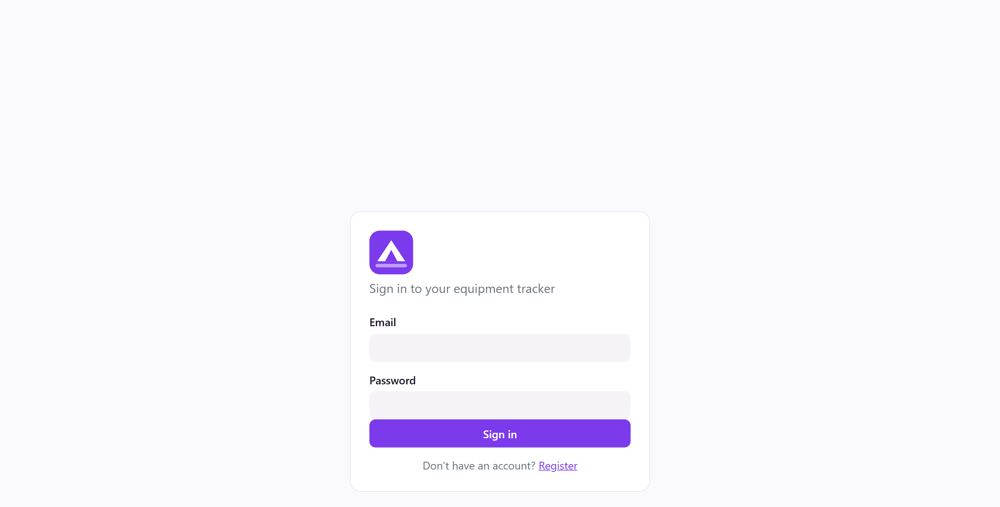

Two public routes exist besides the login: `/register` and `/pending`.

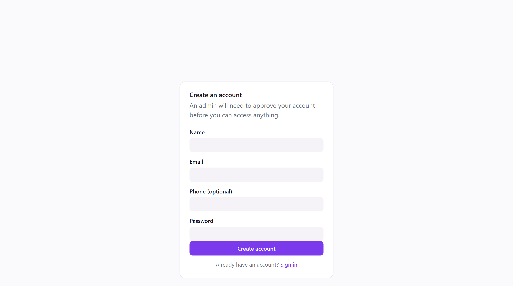

Registration always creates a **Pending / Viewer** account regardless of what the browser sends —
the role and status are hard-coded in a database trigger, so self-registration cannot grant itself
access. A new account lands on the pending screen until an Admin approves it.

### Equipment

The default landing page. Items are grouped **by room** by default, with a count, a total quantity,
and a badge for anything that needs attention.

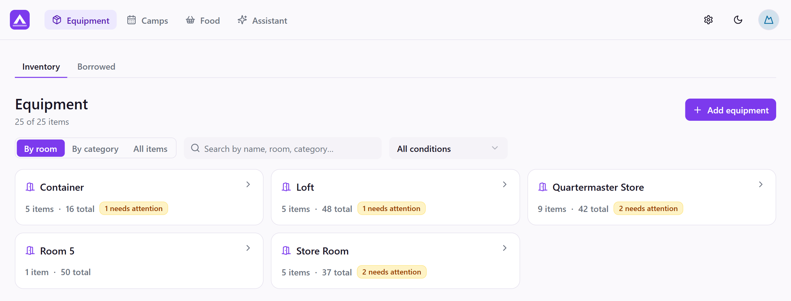

Switching to **All items** gives the flat table: quantity, room, category, condition, when it was
last checked and by whom. Search matches name, room and category; the dropdown filters by
condition.

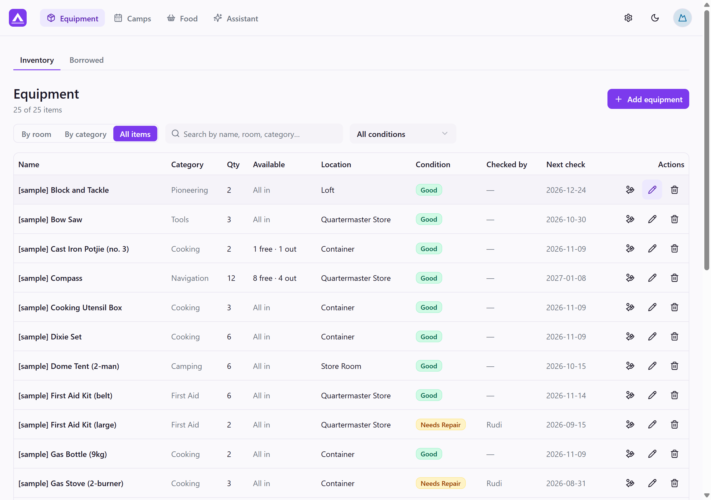

Adding or editing an item opens a dialog. `condition` is constrained by the database to
`Good`, `Needs Repair`, `Broken` or `Missing`.

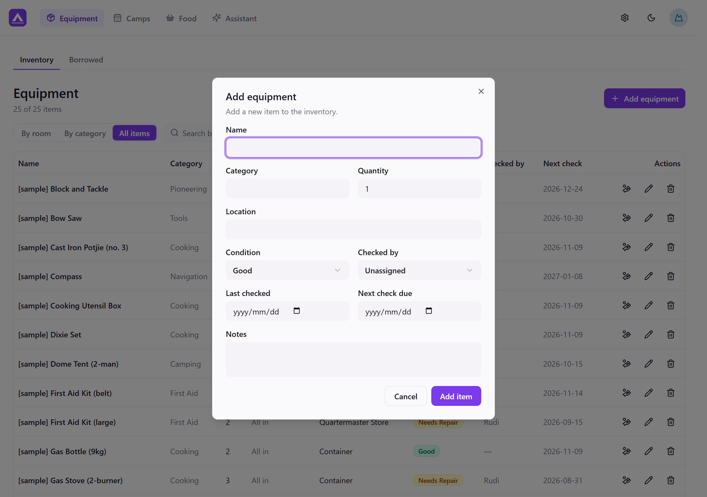

### Borrowing

The second tab of the Equipment section. Loans record who took it, from which Scout group, their
position and contact details, when it went out and when it is due back. A loan with no
`returned_on` is still outstanding.

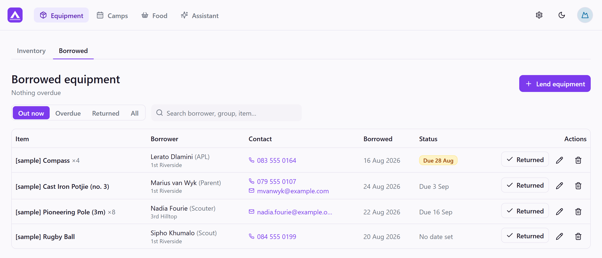

Status is worked out in [`src/lib/loans.ts`](basemind-app/src/lib/loans.ts) by comparing
`yyyy-mm-dd` strings rather than `Date` objects — they sort correctly as text and it sidesteps a
timezone shifting a due date by a day. An item is *due soon* within `DUE_SOON_DAYS` (3) of its due
date. Quantities on loan are subtracted from the equipment list's availability, clamped at zero so
a miscount shows `0` rather than a negative.

### Camps

A month grid plus a list of what's coming up. **Plan a camp** opens the wizard; **Quick add** is
for troop nights and one-off dates.

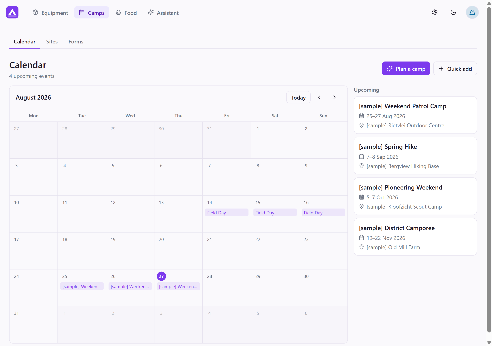

The wizard walks through five steps — Camp, Site, Menu, Equipment, Review — and creates the event,
its packing list and its menu in one pass. Only the first step can block progress (a name and a
start date, with the end date validated against it).

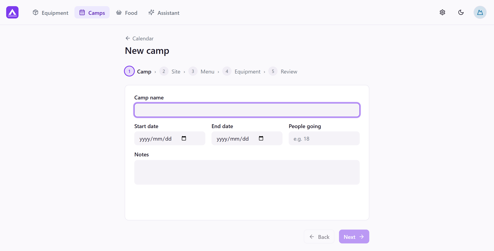

An individual camp is where most of the work happens. This one has a packing list and a food plan:

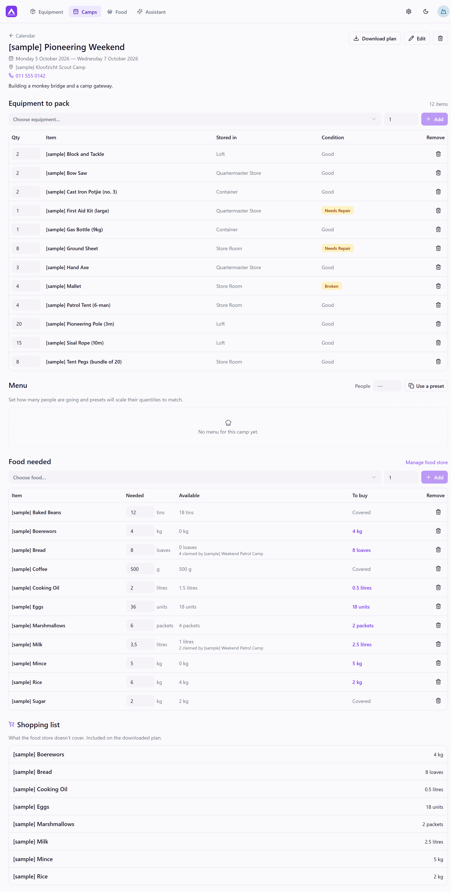

Three things in that screenshot are worth pointing out:

- **Condition travels with the packing list.** A `Needs Repair` or `Broken` item shows its badge
  here, so it is visible at packing time rather than at camp.
- **Other camps' claims are subtracted.** `[sample] Bread` shows *"4 claimed by [sample] Weekend
  Patrol Camp"*. Without this, two camps a fortnight apart would each see the full cupboard and
  neither shopping list would mention the bread the other one is taking. The logic is
  `buildClaims` / `buildFoodPlan` in
  [`src/lib/shoppingList.ts`](basemind-app/src/lib/shoppingList.ts).
- **The shopping list is derived, never typed.** It is the food plan filtered to lines where
  `toBuy > 0`, where `toBuy = needed − (inStock − claimedElsewhere)`.

**Download plan** produces a PDF of the whole thing, site contact details included.

### Camping sites

A directory of venues. Beyond the obvious contact fields, each site carries the emergency
information a safety plan needs: nearest hospital, its phone and address, how far it is, emergency
vehicle access and free-text emergency notes.

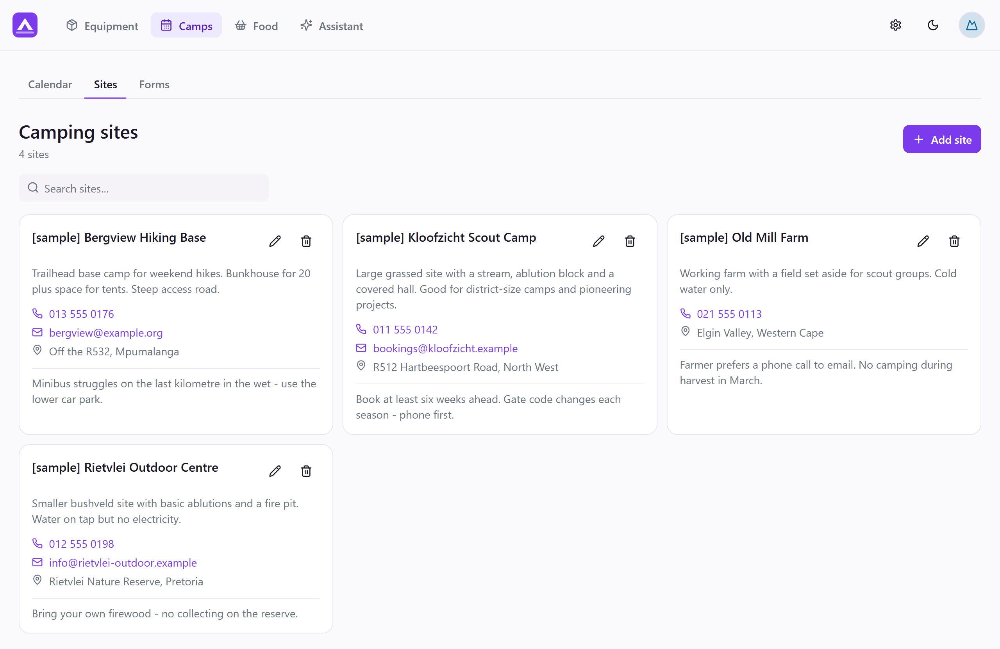

The card only shows the booking details. The emergency fields live in the site's edit form, under
their own heading — along with the app's own warning that none of it is looked up for you:

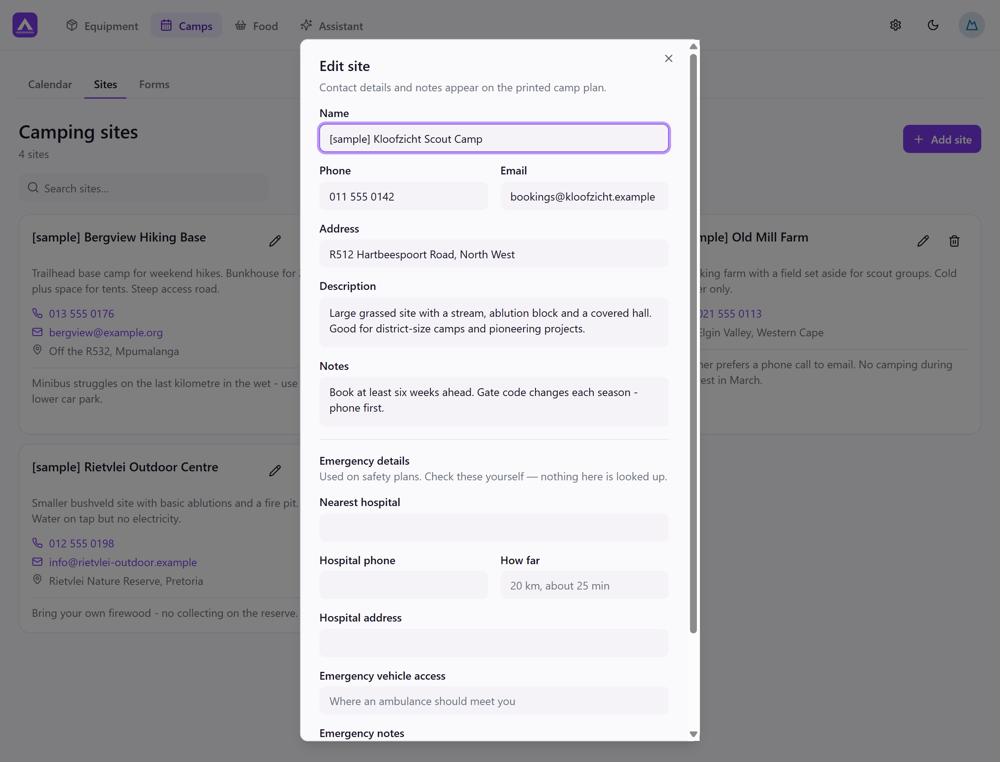

### Forms

Upload an official fillable PDF once, map its own field names to BaseMind data keys, then generate
a filled copy per camp. The mapping lives in the `camp_forms.field_map` column; the PDF itself
lives in a private Supabase Storage bucket.

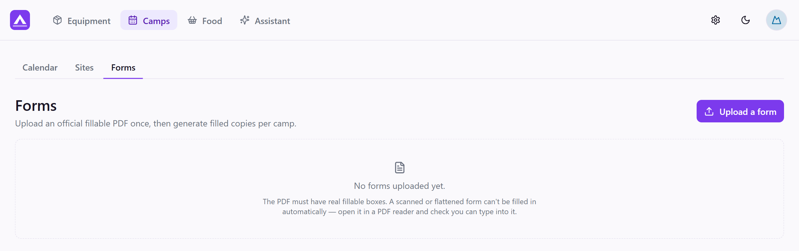

*Nothing has been uploaded in this project yet, so the page is showing its empty state — which is
also where it warns that a scanned or flattened PDF can't be filled in automatically.*

### Food and menus

The food store is a plain inventory in whatever units suit — kg, tins, litres, packets, loaves.

Menus are meal plans: meals per day, ingredients per meal, written for a stated number of people.
A menu with `event_id = null` is a reusable **preset**; one with an `event_id` belongs to a
particular camp. Applying a preset to a camp scales every quantity by `headcount / serves`.

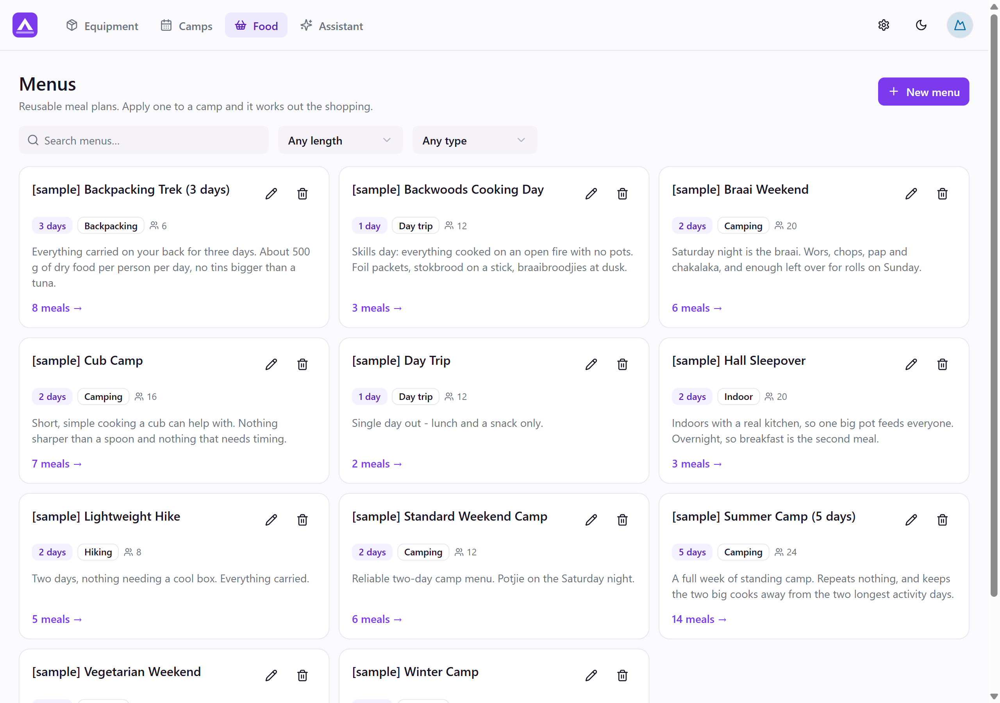

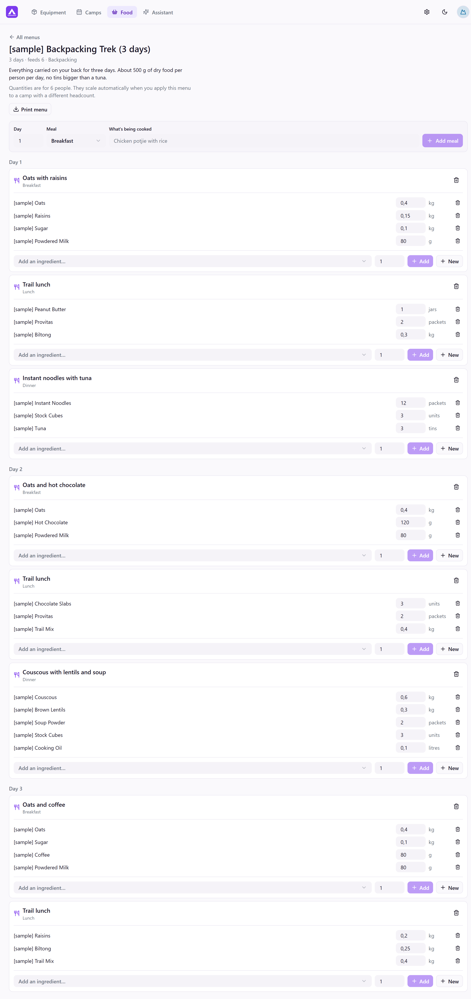

> **Two documented rules, visible in those two screenshots.** Neither shows a "Food store / Menus"
> tab strip, even though `MenusPage` renders `<SectionTabs tabs={FOOD_TABS} />`. Food is switched
> off in this project, which leaves the strip with a single visible tab — and `SectionTabs` returns
> `null` below two. The section still appears in the nav because Menus, its other tab, is on.

The scaling and roll-up live in [`src/lib/menus.ts`](basemind-app/src/lib/menus.ts).
`aggregateMenuRequirements` sums the same ingredient across every meal that uses it — rice at lunch
on day one and dinner on day two is one line on the shopping list, not two — and `mergeRequirements`
folds in anything added by hand on the event.

Two Postgres functions do the copying server-side so it is atomic:
`apply_menu_preset(preset_id, target_event_id, target_headcount)` and
`save_menu_as_preset(source_menu_id, preset_name, preset_category)`.

### Assistant

Its own top-level section with two tabs. **Ask** answers questions from the group's uploaded
documents and nothing else.

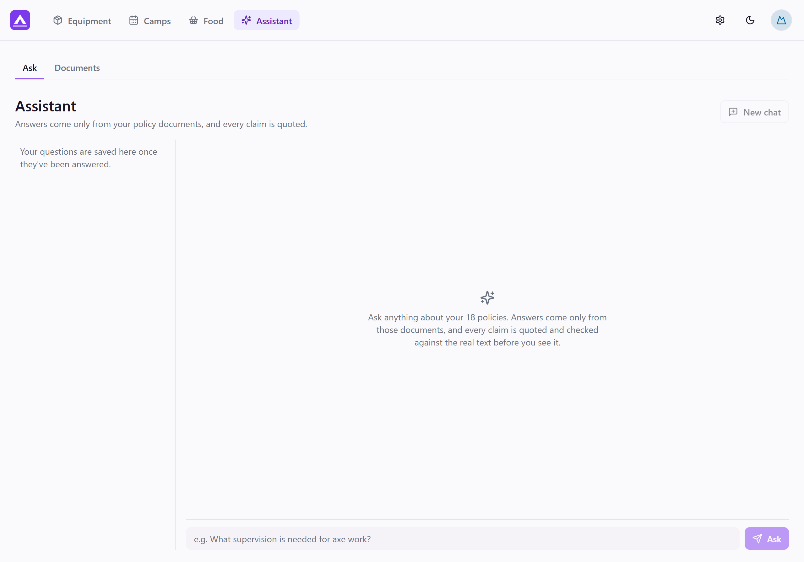

Saved conversations sit in the rail on the left; the empty state names how many documents are
loaded, because an answer can only ever come from those.

**Documents** is where the policies live. Upload a PDF or paste a link to one; the text is
extracted on arrival and stored alongside the original, so the documents stay searchable and
readable with no API key at all.

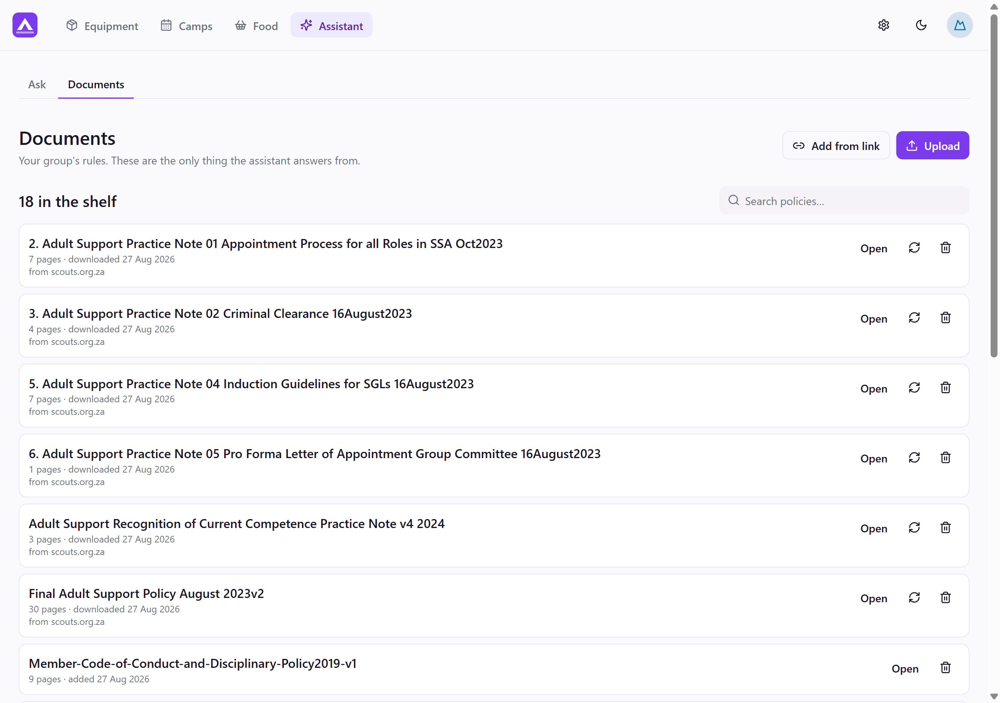

This project has eighteen real Scouts South Africa policy documents loaded. Note the difference
between the rows: those added by link show *"downloaded … from scouts.org.za"* and carry a **↻**
button that re-fetches and replaces them in place, while one added by upload shows *"added"* and
has no ↻ — there is no source to re-fetch from.

Conversations are saved and are **private to whoever asked** — enforced by row-level security on
`policy_chats`, not just by the UI. Only the last three exchanges are replayed to the model, which
is enough for a follow-up like *"and what about cubs?"* without pushing the documents down a prompt
that grows every turn.

### Admin

Admin-only. Feature switches, and a link through to user management.

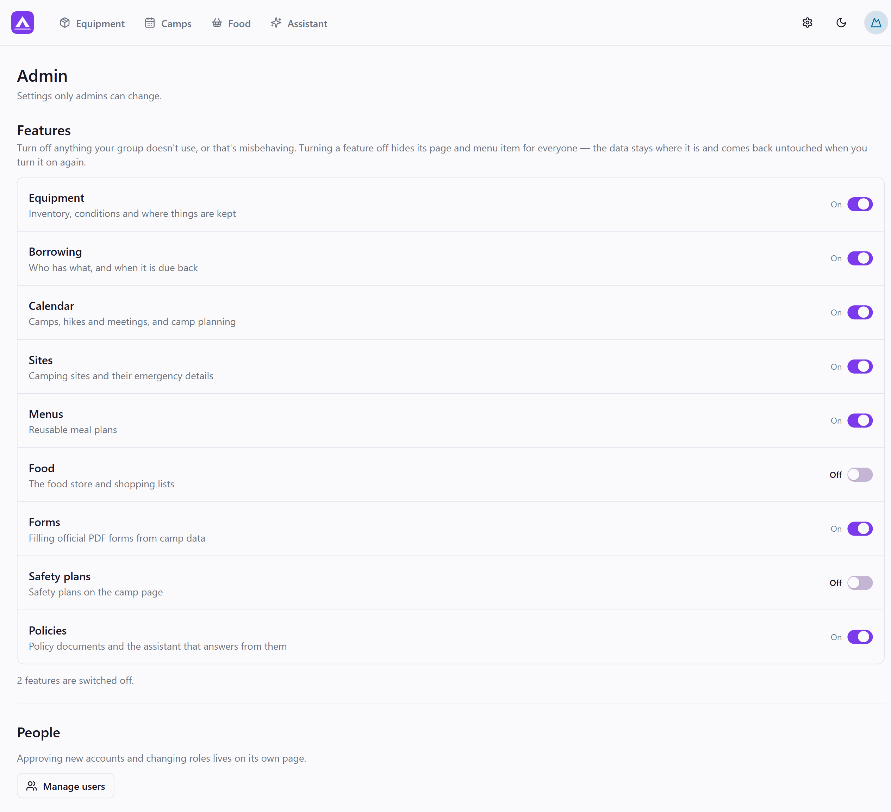

Turning a feature **off** asks for confirmation, because it takes the page away from everyone.
Turning it back on doesn't — making both directions equally hard would just train people to click
through. The data is untouched either way.

A route whose feature is off renders this rather than 404ing:

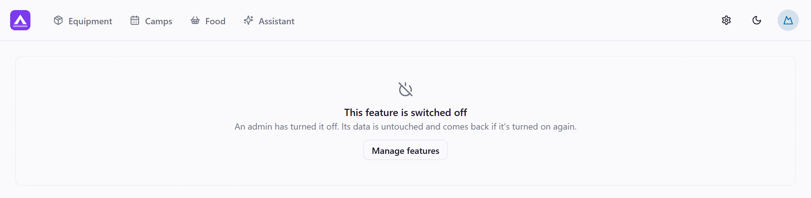

### Users

Approving signups, changing roles, deactivating accounts. Admin only, at both the route level and
the database level.

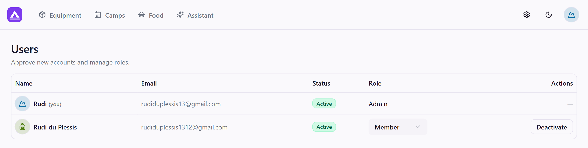

### Your profile

Details, appearance (including the icon picker), and account settings such as changing a password.

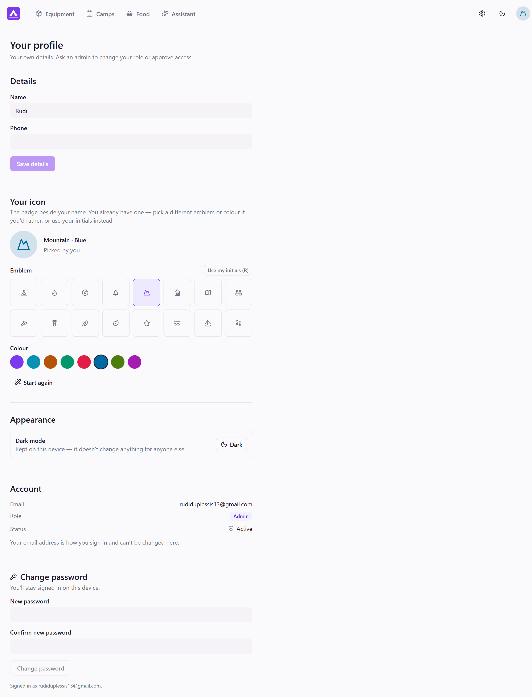

### Dark mode and mobile

The theme is a class on `<html>`, persisted to `localStorage` under `basemind-theme`. Every colour
is a CSS variable in [`src/styles/theme.css`](basemind-app/src/styles/theme.css), including the
eight person-icon hues, so they swap together.

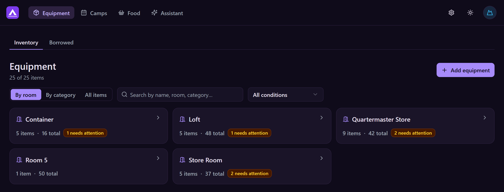

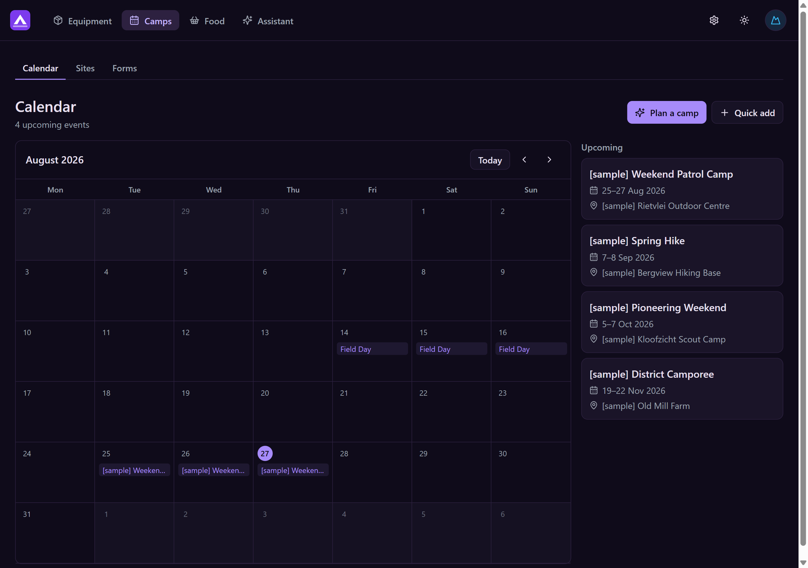

On a phone the header nav is hidden and a fixed bottom bar takes over — four wide targets that are
easier to reach one-handed than a row that scrolls off the edge.

<p align="center">
  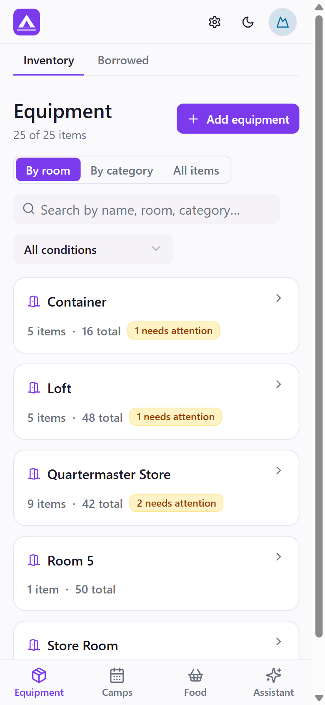
  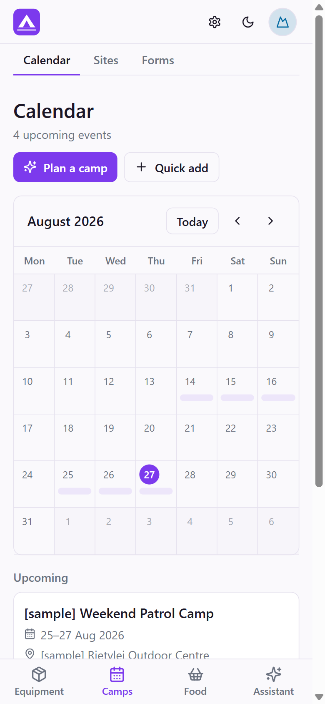
</p>

---

## 3. Roles and permissions

Four roles and three account statuses.

```
status:  Pending  →  Active     (an Admin approves)
                  →  Rejected   (an Admin rejects, or later deactivates)

role:    Viewer   (the default every new account gets)
         Member
         Manager
         Admin
```

Only an **Active** account can do anything at all. Pending and Rejected accounts fail
`is_active_user()` in every policy, so they are blocked at the database, not merely redirected.

| Capability | Admin | Manager | Member | Viewer |
|---|:--:|:--:|:--:|:--:|
| Read everything | ✅ | ✅ | ✅ | ✅ |
| Add / edit equipment, camps, sites, food, menus, loans, forms | ✅ | ✅ | ✅ | — |
| Delete those | ✅ | ✅ | — | — |
| Add / edit / delete policy documents | ✅ | ✅ | — | — |
| Ask the assistant | ✅ | ✅ | ✅ | ✅ |
| Approve signups, change roles, deactivate | ✅ | — | — | — |
| Toggle feature switches | ✅ | — | — | — |

Note the deliberate asymmetry on policies: **only Admins and Managers can change documents**,
because an answer is only as trustworthy as who can edit what it answers from.

Own-row exceptions: anyone can read and update their **own** `users` row (their name, phone and
icon choice) — but a trigger reverts any attempt to change their own `role` or `status`.

Chats are stricter still: `policy_chats` and `policy_chat_messages` are visible only to the user
who owns them, whatever their role.

---

## 4. Architecture

### Stack

| Layer | Choice |
|---|---|
| UI | React 18.3, TypeScript 5.4 |
| Build | Vite 6.4, `vite-plugin-pwa` 0.21 |
| Styling | Tailwind CSS v4 (via `@tailwindcss/vite`), CSS variables for theming |
| Components | Radix UI primitives in the shadcn/ui pattern, `lucide-react` icons |
| Routing | React Router 7.18, `createBrowserRouter` |
| Backend | Supabase — Postgres, Auth, Row Level Security, Realtime, Storage, Edge Functions |
| PDFs | `jspdf` + `jspdf-autotable` to write, `pdf-lib` to fill, `pdfjs-dist` to read — all lazy |
| Toasts | `sonner` |
| Dates | `date-fns` 3.6 |

There is no state-management library, no data-fetching library and no test framework. State lives
in five context providers and one reusable realtime hook.

### Directory map

```
BaseMind3.0-main/
├── README.md                     project background and history
├── DOCUMENTATION.md              this file
├── docs/screenshots/             the images used above
└── basemind-app/
    ├── index.html                the shell; the PWA manifest link is injected at build
    ├── vite.config.ts            aliases, PWA/workbox config, manual chunk splitting
    ├── vercel.json               build command, output dir, SPA rewrite
    ├── .env.example              the two variables you must set
    ├── public/favicon.svg        the tent mark; also the PWA icon
    ├── supabase/
    │   ├── migrations/           0001 … 0011, run in order, once each
    │   ├── seed/                 dummy_data.sql and remove_dummy_data.sql
    │   └── functions/            three Deno Edge Functions, deployed by hand
    └── src/
        ├── main.tsx              root render + stale-build handler
        ├── App.tsx               provider stack + missing-config screen
        ├── routes.tsx            the router, lazy imports, feature/role gates
        ├── types/database.ts     every row type, and the typed Database generic
        ├── context/              Auth, Equipment, Features, Offline, Theme
        ├── lib/                  all the business logic, framework-free
        │   ├── supabase/         client and env handling
        │   └── offline/          IndexedDB wrapper and the outbox
        └── components/
            ├── ui/               the shadcn/Radix primitives
            ├── layout/           AppLayout, SectionTabs, guards, error+offline banners
            └── <feature>/        one folder per feature area
```

### The provider stack

From [`src/App.tsx`](basemind-app/src/App.tsx), outermost first:

```
ThemeProvider              light/dark class on <html>, persisted
 └── (missing env vars? → render the config screen instead of the app)
     └── OfflineProvider   online/offline, the outbox, sync on reconnect
         └── AuthProvider  session, profile, role checks, cached-profile fallback
             └── FeaturesProvider  the feature_flags table, live
                 └── RouterProvider + Toaster
```

The ordering is load-bearing. `AuthProvider` sits inside `OfflineProvider` because the cached
profile is what keeps an already-signed-in leader from being bounced to the login screen with no
signal. `FeaturesProvider` sits inside `AuthProvider` because reading `feature_flags` requires an
active session.

If `VITE_SUPABASE_URL` or `VITE_SUPABASE_ANON_KEY` is missing, the whole router is replaced by a
screen naming the missing variables. The Supabase client itself falls back to a dummy URL, because
`createClient` throws on an empty one and that would blank the page before React could explain
anything.

### Routing

[`src/routes.tsx`](basemind-app/src/routes.tsx). The three auth pages are eagerly loaded — they are
the first thing anyone sees, so splitting them would only add a spinner to the critical path.
**Everything behind the login is lazy**, which keeps the initial download small on a phone with
camp-grade signal.

| Route | Gate |
|---|---|
| `/login`, `/register`, `/pending` | public |
| `/` | redirects to `/equipment` |
| `/equipment` | signed in + Active (wrapped in `EquipmentProvider`) |
| `/loans` | feature `loans` |
| `/events`, `/events/new`, `/events/:eventId` | feature `events` |
| `/sites` | feature `sites` |
| `/menus` | feature `menus` |
| `/food` | feature `food` |
| `/forms` | feature `forms` |
| `/assistant`, `/policies` | feature `policies` |
| `/profile` | signed in |
| `/admin`, `/users` | role `Admin` |
| `*` | redirects to `/` |

`AppLayout` is the real access gate: no session → `/login`; no profile or `status !== "Active"` →
`/pending`.

Note that `/equipment` has **no** feature gate on the route even though an `equipment` flag exists.
Turning that flag off removes the Inventory tab and the section link, but the route itself still
renders — and `/` still redirects to it.

### Navigation structure

Four sections in the bar, not eight destinations — eight items never fitted a phone. Related pages
are tabs *within* a section, defined once in
[`SectionTabs.tsx`](basemind-app/src/components/layout/SectionTabs.tsx):

| Section | Tabs |
|---|---|
| Equipment | Inventory (`/equipment`), Borrowed (`/loans`) |
| Camps | Calendar (`/events`), Sites (`/sites`), Forms (`/forms`) |
| Food | Food store (`/food`), Menus (`/menus`) |
| Assistant | Ask (`/assistant`), Documents (`/policies`) |

A section's tabs are its source of truth: it survives as long as **any one** of them is switched
on, and points at the first one that is. Gating a section on a single feature meant turning off
Food also hid Menus, which sits in the same section but has its own switch. A tab strip with only
one remaining tab renders nothing.

Admin is deliberately not in this bar — settings live in the header, permanently visible, never
pushed into an overflow menu.

### The realtime data pattern

Almost every page uses one hook,
[`useRealtimeTable`](basemind-app/src/lib/useRealtimeTable.ts):

```ts
const { rows, loading, error } = useRealtimeTable("events", { orderBy: "start_date" });
```

What it does, in order:

1. Reads the last known rows from IndexedDB and renders them immediately. At camp this is often the
   only data there is, and even on a good connection it beats a spinner.
2. Fetches the table from Supabase, sorts, renders, and writes the fresh copy back to IndexedDB.
3. Subscribes to `postgres_changes` for that table and folds INSERT/UPDATE/DELETE into local state
   via [`applyRealtimeChange`](basemind-app/src/lib/applyRealtimeChange.ts).
4. Suppresses the fetch error entirely if there was a usable cache — the offline banner already
   explains the situation, and there is nothing the user could act on.

The consequence worth internalising: **mutations do not update local state.** They write to
Supabase per row and let the realtime event come back and do it. That is what keeps two leaders'
tabs in step, and it is what the old app got wrong with whole-table rewrites.

`primaryKey` defaults to `"id"`; `feature_flags` passes `"key"` because that is its primary key.

`EquipmentContext` is an older, hand-rolled version of the same pattern, scoped to the `/equipment`
route rather than global.

### Bundle strategy

`vite.config.ts` splits `react`/`react-dom`/`react-router` and `@supabase/supabase-js` into their
own chunks — they change far less often than app code, so a normal deploy doesn't invalidate them
in the browser cache. A production build currently emits roughly 56 precached entries at ~2.5 MB
total, with the heavy PDF libraries in separate chunks fetched only on the pages that need them.

### Recovering from a deploy that lands mid-session

A real failure mode for a long-lived tab: the app is code-split into chunks whose filenames contain
a build hash, so after a deploy an open page still refers to the *previous* build's filenames — and
those are gone. The next navigation throws `Failed to fetch dynamically imported module` and the
app falls over.

[`src/lib/staleDeploy.ts`](basemind-app/src/lib/staleDeploy.ts) handles it:

- `installStaleBuildHandler()` (called in `main.tsx`) listens for `unhandledrejection` and `error`,
  catching failures that happen outside React's error boundary — a hover-triggered prefetch, or a
  lazy import that rejects between renders.
- `RouteError` catches the same thing inside the router.
- Recovery is a single reload, recorded in `sessionStorage`, so a genuinely broken build shows a
  real error instead of reloading forever.
- The service worker is configured with `skipWaiting`, `clientsClaim` and
  `cleanupOutdatedCaches`, so the new build takes over immediately rather than waiting for every
  tab to close.

---

## 5. The data model

Eighteen tables. Every one has RLS enabled. Fifteen of them are in the `supabase_realtime`
publication — the exceptions are `users`, `policy_chats` and `policy_chat_messages`, none of which
benefit from being broadcast (a profile is fetched on sign-in, and a chat is private to one person
anyway).

```
auth.users ──(trigger)──▶ public.users
                             │
                             ├── equipment.checked_by
                             ├── policies.created_by
                             └── policy_chats.user_id ──▶ policy_chat_messages.chat_id

equipment ──▶ equipment_loans          (who has what, and when it's due)
          └──▶ event_equipment ◀── events            (the packing list)

camping_sites ◀── events ──▶ event_food ──▶ food_items   (the food plan)
      │              │
      │              ├──▶ menus ──▶ menu_meals ──▶ menu_meal_items ──▶ food_items
      │              └──▶ safety_plans ──▶ safety_scenarios
      └── hospital_*, emergency_* columns feed the safety plan

camp_forms          (an uploaded fillable PDF + its field mapping)
feature_flags       (the switches on the admin page)
policies            (documents + extracted text)
```

### Table reference

| Table | Migration | What it holds |
|---|---|---|
| `users` | 0001 | Profile mirror of `auth.users`: name, phone, `role`, `status`, icon choice |
| `equipment` | 0001 | Name, category, quantity, location, condition, notes, check dates |
| `camping_sites` | 0003, 0006 | Venue contact details; hospital and emergency fields added in 0006 |
| `events` | 0003, 0005 | Camps, hikes, meetings; `headcount` added in 0005 |
| `event_equipment` | 0003 | The packing list — a join of event ↔ equipment with a quantity |
| `food_items` | 0003 | The food store: name, unit, quantity, category |
| `event_food` | 0003 | Food required for an event |
| `equipment_loans` | 0004 | Borrower, group, position, contacts, dates; `returned_on` null = still out |
| `menus` | 0005 | `event_id = null` → reusable preset; otherwise a camp's own menu |
| `menu_meals` | 0005 | Day number, meal slot, name, notes |
| `menu_meal_items` | 0005 | Ingredient lines: meal ↔ food item + quantity |
| `safety_plans` | 0006 | Leader, standby, first aider, emergency numbers, generated text |
| `safety_scenarios` | 0006 | Per-situation response, destination, contact, sort order |
| `camp_forms` | 0007 | Uploaded PDF's storage path + `field_map` (JSON) |
| `feature_flags` | 0008, 0009 | Nine switches, keyed by `key` rather than `id` |
| `policies` | 0009, 0011 | Title, category, storage path, extracted `content`, page count, source URL |
| `policy_chats` | 0011 | One saved conversation, owned by a user |
| `policy_chat_messages` | 0011 | Turns within a chat; assistant rows carry the verified result |

### Conventions

- **Primary keys** are `uuid` defaulted from `uuid_generate_v4()`, except `users.id` (which
  references `auth.users(id)`) and `feature_flags.key` (text).
- **`updated_at`** is maintained by a shared `set_updated_at()` trigger, not by the client.
- **Dates** that represent a calendar day (`start_date`, `due_back`, `borrowed_on`) are `date`, and
  are compared as `yyyy-mm-dd` strings in the app to avoid timezone drift.
- **Quantities** are rounded through `roundQuantity()` (three decimal places) wherever they are
  summed, to shake off float artefacts like `0.30000000000000004`.
- **Row types** in `src/types/database.ts` must be `type` aliases, never `interface`. Supabase's
  client generic constrains every row to `Record<string, unknown>`, and an interface has no implicit
  index signature — using one silently degrades every insert/update argument to `never`.

### The two database functions

Menu copying happens in Postgres rather than in the browser so it is atomic:

| Function | Signature | Does |
|---|---|---|
| `apply_menu_preset` | `(preset_id uuid, target_event_id uuid, target_headcount int default null)` → `uuid` | Copies a preset, its meals and its ingredients onto an event, scaling quantities |
| `save_menu_as_preset` | `(source_menu_id uuid, preset_name text, preset_category text default null)` → `uuid` | Copies a camp's menu back into the reusable library |

---

## 6. The security model

This is the part the rebuild exists for, so it is worth reading properly.

### Signup cannot elevate itself

`handle_new_user()` is an `after insert` trigger on `auth.users`. It creates the `public.users` row
with `role` and `status` **hard-coded** to `'Viewer'` and `'Pending'`, ignoring anything the client
put in its signup metadata. Only `name` and `phone` are taken from the client.

There is deliberately **no INSERT policy** on `public.users`. The trigger is `security definer` and
bypasses RLS; client-initiated inserts are default-denied.

### Two helper functions decide everything

```sql
public.current_role()    -- the caller's role, or NULL
public.is_active_user()  -- true only when the caller's status is 'Active'
```

Both are `security definer` and `stable`. That matters: they must bypass RLS internally, otherwise
querying `users` from inside a policy defined *on* `users` recurses.

### The standard policy shape

Migrations 0003, 0005 and 0006 apply this to every table they create, via a `do $$` loop over a
table-name array:

```sql
select  →  is_active_user()
insert  →  is_active_user() and current_role() in ('Admin','Manager','Member')
update  →  is_active_user() and current_role() in ('Admin','Manager','Member')
delete  →  is_active_user() and current_role() in ('Admin','Manager')
```

Deviations from that shape, all intentional:

| Table | Deviation |
|---|---|
| `users` | select: own row **or** any active user. update: own row **or** an Admin. delete: Admin only. No insert policy. |
| `policies` | insert/update/delete require **Admin or Manager** — Members cannot change what the assistant answers from. |
| `feature_flags` | select: any active user (the nav needs them). update: Admin only. No insert or delete policy — the set of features is defined by migrations, not by users. |
| `policy_chats`, `policy_chat_messages` | Scoped to `user_id = auth.uid()` for every operation, regardless of role. Messages check ownership through their parent chat. |

### Column-level protection for role and status

RLS's `WITH CHECK` can gate a whole row but not individual columns. A user allowed to update their
own row could therefore set `role = 'Admin'` themselves. The `protect_user_fields()` trigger closes
that:

```sql
if auth.uid() is not null and public.current_role() is distinct from 'Admin' then
  new.role   := old.role;
  new.status := old.status;
end if;
```

The `auth.uid() is not null` check is the subtle part, and is the entire subject of migration 0002.
Statements from the SQL Editor or the `service_role` key carry no JWT, so `auth.uid()` is NULL and
`current_role()` returns NULL — "distinct from Admin" — and without this guard the documented
first-admin bootstrap would report success while silently changing nothing. Those callers already
bypass RLS and are fully trusted; anon clients are blocked by the `users_update` policy instead.

### Storage

Two private buckets, both with policies mirroring their tables:

| Bucket | Created in | Read | Write | Delete |
|---|---|---|---|---|
| `camp-forms` | 0007 | any active user | Admin / Manager / Member | Admin / Manager |
| `policies` | 0009 | any active user | Admin / Manager | Admin / Manager |

Migration 0010 removes an older `avatars` bucket entirely — person icons are drawn by the app, so
nothing needs uploading. Note the comment in that file: deleting rows from `storage.objects` does
not reclaim the underlying files.

### What this buys you

The check that actually matters, from the verification list: sign in as a Viewer, take that
session's token, and `POST` directly to the Supabase REST `equipment` endpoint, bypassing the UI
entirely. Postgres rejects it. That is the server-side enforcement the original app never had.

---

## 7. Offline behaviour

Three separate mechanisms, each covering a different failure.

**1. The app shell.** `vite-plugin-pwa` precaches every JS, CSS, HTML, SVG and WOFF2 asset
(`maximumFileSizeToCacheInBytes` is raised to 5 MB because `pdf-lib` alone is ~440 kB and the
default 2 MB cap would skip it), with `navigateFallback: "index.html"`. Supabase requests are
explicitly `NetworkOnly` — data is cached by the app in IndexedDB, not by the service worker, and
serving a stale auth round-trip would be actively harmful.

**2. Reading.** `useRealtimeTable` caches each table in IndexedDB and renders from it first.
`AuthProvider` caches the user's profile under `profile:<id>` and falls back to it when the server
can't be reached — so an already-signed-in leader with no signal stays signed in. The cached role
decides what the UI *offers*, never what the database *allows*; RLS still runs server-side, so a
stale cached role cannot actually do anything.

**3. Writing.** [`OfflineContext`](basemind-app/src/context/OfflineContext.tsx) keeps an outbox in
IndexedDB. `addRow(table, row)` inserts directly when online; when offline — or when the error looks
like a network failure rather than a rejection — it queues. On reconnect it waits a second for the
connection to settle, then replays. Genuine rejections (RLS, constraint violations) surface
immediately rather than being queued to fail again later; permanently failed rows are surfaced in a
`failed` list so they are not lost silently.

The split between adding and editing is deliberate, and lives in
[`useWritePermissions`](basemind-app/src/lib/useWritePermissions.ts):

```ts
canAdd    = Admin | Manager | Member          // allowed offline: queued and replayed
canEdit   = (Admin | Manager | Member) && online
canDelete = (Admin | Manager) && online
```

Adding queues safely — two people adding different rows never collide. Editing or deleting the same
row *does* collide, and resolving that without asking would mean quietly discarding someone's work.
So those are paused until there is a connection to check against, and `blockedByOffline` tells the
UI to explain that rather than just hiding the button.

**Failing open.** `FeaturesContext.isEnabled()` returns `true` for any flag it doesn't have. If the
flags table can't be read — offline before it was ever cached, or migration 0008 not yet run —
hiding the whole app would be far worse than showing a section someone turned off.

---

## 8. The AI features and how they are constrained

Two optional features use Gemini. Both work on the same principle: **the model's instruction not to
invent things is not trusted; its output is verified against the source data and discarded if it
doesn't match.** Both have a fully working non-AI path.

The API key never reaches the browser. It lives as a Supabase Edge Function secret; a `VITE_`
variable would be baked into the bundle and readable by anyone who opens devtools.

### The three Edge Functions

| Function | Secrets | Without it |
|---|---|---|
| `safety-plan` | `GEMINI_API_KEY` | The "Rewrite more readably" button errors; the template still works |
| `policy-chat` | `GEMINI_API_KEY` | Documents still upload, search and open; only the question box errors |
| `fetch-policy-pdf` | none | Uploading files still works; only "add by link" is unavailable |

Both AI functions default to `gemini-3.5-flash-lite` — the cheapest class with the most generous
free quota, and its thinking level already defaults to minimal so none of the output budget goes on
reasoning. Override it with a **`GEMINI_MODEL`** secret; no code change needed. If the name isn't
available on your key the call fails with a 404, and the error names both the model it tried **and
lists the models your key can actually use**.

> **These functions are deployed by hand.** They do not update from a git push. After editing one
> here you must paste it into the Supabase dashboard again.

### Safety plans

The plan is built entirely from what a leader types in, plus the emergency fields on the camping
site. Nothing is looked up or inferred.

[`collectFacts()`](basemind-app/src/lib/safetyPlan.ts) flattens everything into labelled
`{ label, value }` pairs. That single list is both what the deterministic template renders *and*
what any generated prose is checked against — so the two cannot drift apart.

The optional rewrite sends those facts to Gemini to be phrased as flowing paragraphs, constrained
three ways:

1. The key is server-side.
2. The model is told to use only the supplied facts.
3. **Every number in the reply is checked against the facts before it is shown.** A reply
   containing an unrecognised number is discarded and you keep the plain version.

`safety_plans.generated_by` records `'template'` or `'gemini'` so you can always tell which you are
looking at. Whatever produced it, read the plan before you rely on it.

### The assistant

**Getting text in.** [`documentText.ts`](basemind-app/src/lib/documentText.ts) extracts text from a
PDF with `pdf.js` (lazy-loaded — it is ~350 kB and only needed when someone adds a document) or
reads a plain-text/Markdown file directly. Incidental PDF spacing is collapsed to single spaces,
because citations are later matched against this stored text. A PDF yielding no text — a scan or a
photograph — is **rejected at upload** with an explanation, rather than silently becoming a document
that never appears in any answer.

**Replacing, not duplicating.** A document whose title you already have replaces the existing one; a
unique index on `lower(title)` enforces it. Two copies means the assistant quotes whichever it read
first, and an edit to one silently doesn't apply. Migration 0011 renames any pre-existing duplicates
rather than deleting them.

**Adding by link.** `fetch-policy-pdf` downloads server-side, because almost nothing serves a PDF
with headers that allow a cross-origin read — and because at camp the user's connection is the one
you least want to spend on a 4 MB file. It is fetching a URL somebody typed, from inside your
infrastructure, which is the classic shape of a server-side request forgery, so it:

- accepts only `http`/`https`
- requires the caller to be an **Active Admin or Manager**, checked against the database
- follows redirects by hand, re-checking the destination at every hop (max 3)
- refuses loopback, private, link-local and cloud-metadata addresses
- requires the response to actually be a PDF, capped at 15 MB

The file's own comments name the residual risk honestly: a public hostname that resolves to a
private address (DNS rebinding) is not caught, because name resolution isn't available there to
check.

A document added by link keeps its URL, so the ↻ button re-downloads and replaces it in place when
the source is updated.

**Verifying answers.** This is the core of it, in
[`policyChat.ts`](basemind-app/src/lib/policyChat.ts). The model is asked to return an answer plus
citations, each naming a policy and quoting it verbatim. Then `verifyAnswer()`:

1. Resolves each citation's policy by id, falling back to a normalised title match.
2. Looks the quote up in that policy's stored text via `quoteAppearsIn()`.
3. Drops anything that fails, into a `rejected` list with a reason
   (`unknown-policy` or `quote-not-found`).
4. De-duplicates repeated quotes.
5. Sets `unsupported` when the answer made claims but **none** could be traced to a policy.

Matching is whitespace- and case-insensitive but **keeps punctuation** — PDF extraction introduces
line breaks and runs of spaces that don't exist in the sentence a reader sees, so an exact match
would reject honest quotes, while dropping punctuation would let meaningfully different text match.
Quotes shorter than 12 characters are never accepted: they match by accident and are evidence of
nothing.

A citation nobody can follow is worse than no citation, because it looks authoritative. That is why
these are discarded rather than shown with a warning.

The same check runs in the Edge Function *and* again in the browser.

**Saying "not covered".** The model returns a `covered` flag and, when false, a list of questions the
documents *can* answer. That flag is optional in the type — the Edge Function is deployed by hand,
so a browser may be talking to an older version that never sends it, and a missing flag therefore
means "work it out from the prose", not "not covered".

**Chats.** Nothing is written until an answer actually arrives, so a failed question leaves no
half-conversation behind. Only the last three exchanges are replayed to the model.

---

## 9. PDF generation and form filling

Three separate PDF concerns, three separate libraries, all loaded on demand.

| Concern | Library | Where |
|---|---|---|
| Writing a camp plan / menu | `jspdf` + `jspdf-autotable` | `lib/campPlanPdf.ts`, `lib/menuPdf.ts` |
| Filling an existing fillable PDF | `pdf-lib` | `lib/formFill.ts` |
| Reading text out of a PDF | `pdfjs-dist` | `lib/documentText.ts` |

### The camp plan

`campPlanPdf.ts` assembles the event, its site (contact details included), the menu days, the
packing list, the food plan and the shopping list into one printable document. Filenames are
slugged: `camp-plan-<slug>-<start-date>.pdf`.

### Form filling

Upload an official fillable PDF once. BaseMind reads its field names and you map each to a data key
from `FIELD_OPTIONS` in [`formFill.ts`](basemind-app/src/lib/formFill.ts), grouped as Camp, Site,
Hospital, Safety and Other — for example `event.date_range`, `hospital.phone`,
`safety.leader_in_charge`, `safety.full_text` (the whole rendered plan), `today`.

The mapping is stored in `camp_forms.field_map`; generating a filled copy for a camp resolves each
key against that camp's data.

> **A maintenance note that is in the source and worth repeating:** these keys are stable strings
> stored in the database. Renaming one orphans every existing mapping. Add new keys rather than
> changing old ones.

---

## 10. Person icons

Everyone gets a camp badge — one of sixteen emblems in one of eight colours, 128 combinations —
shown in the header and anywhere people are listed.

It is **computed from the user's id in the browser**, which is the whole point:

- a new account has one immediately, with nothing to upload and nothing to set up
- it is identical on every device
- it still draws with no connection
- there is no state in which somebody has no icon

The eight hues are the `--avatar-N` variables in `theme.css`, so they swap for dark mode with
everything else.

**Your profile → Your icon** lets you pin an emblem and colour instead of taking the ones your id
chose, or switch to your initials. Two nullable columns (`avatar_emblem`, `avatar_colour`) store
that choice; `INITIALS` is a reserved value that can never collide with an emblem key. "Start
again" clears both and hands the choice back to your id.

No image is uploaded, generated or hosted anywhere. Migration 0010 deletes the old `avatars`
storage bucket accordingly.

---

## 11. Feature flags

Nine switches, one row each in `feature_flags`. Rows rather than a single settings blob, so two
admins toggling different things cannot overwrite each other.

| Key | Label | Gates |
|---|---|---|
| `equipment` | Equipment | The Inventory tab (**not** the `/equipment` route itself) |
| `loans` | Borrowing | `/loans` |
| `events` | Calendar | `/events`, `/events/new`, `/events/:id` |
| `sites` | Sites | `/sites` |
| `menus` | Menus | `/menus` |
| `food` | Food | `/food` |
| `forms` | Forms | `/forms` |
| `safety` | Safety plans | The safety plan section on the camp page |
| `policies` | Policies | `/assistant` and `/policies` |

Changes propagate live over Realtime — no redeploy, no refresh. Turning something off hides its page
and menu item for everyone; the data stays exactly where it is and comes back untouched.

---

## 12. Setting it up from scratch

### Prerequisites

- Node.js 20 or newer, and npm
- A Supabase account
- Optionally, a Google AI Studio key if you want the two AI features

### Step 1 — Install

```bash
cd basemind-app
npm install
```

### Step 2 — Create a Supabase project

Create one at [supabase.com/dashboard](https://supabase.com/dashboard). From **Project Settings →
API**, note the **Project URL** and the **anon / public key**. The anon key is meant to be public —
RLS is what protects the data, not key secrecy.

### Step 3 — Run the migrations

Open the SQL Editor and run everything in
[`basemind-app/supabase/migrations/`](basemind-app/supabase/migrations/) **in order, once each**:

| Migration | Adds |
|---|---|
| `0001_init.sql` | `users` and `equipment`, the signup trigger, the RLS helpers, the first policies |
| `0002_fix_admin_bootstrap.sql` | Nothing on a fresh project — see the long note inside the file |
| `0003_camps_and_food.sql` | Camping sites, events, packing lists, food store, camp food plans |
| `0004_equipment_loans.sql` | Borrowing |
| `0005_menus.sql` | Menus, meals, ingredients, event `headcount`, the two menu functions |
| `0006_safety.sql` | Hospital/emergency fields per site, safety plans and scenarios |
| `0007_camp_forms.sql` | Uploaded fillable PDFs, their field mappings, the `camp-forms` bucket |
| `0008_feature_flags.sql` | The eight original feature switches |
| `0009_policies.sql` | Policy documents, extracted text, the `policies` bucket, the ninth switch |
| `0010_user_icons.sql` | The emblem/colour columns; removes the old `avatars` bucket |
| `0011_assistant_chats.sql` | Saved chats and messages, policy source URLs, unique titles |

`0002` and `0010` are safe to run twice; the rest are not, so keep track of which you have done.
The calendar, sites and food pages will error until `0003` has been applied.

> **Note:** `basemind-app/README.md` lists migrations only as far as `0010`. `0011` exists and is
> required for the assistant's saved chats and for adding policies by link.

Using the CLI instead: `supabase link` then `supabase db push`.

### Step 4 — Environment variables

```bash
cp .env.example .env.local
```

```env
VITE_SUPABASE_URL=https://<your-project>.supabase.co
VITE_SUPABASE_ANON_KEY=<your anon key>
```

Both are required. Missing either one replaces the app with a screen naming what's absent.
`.env.local` is gitignored.

### Step 5 — Run it

```bash
npm run dev
```

Vite serves on port 5173 with `--host`, so it is reachable from a phone on the same network.

### Step 6 — Decide on email confirmation

Supabase turns **Confirm email** on by default, so every new account must click a link before it can
sign in. This app already gates access behind admin approval, so that step is mostly redundant
friction for a small group.

To turn it off: **Authentication → Providers → Email →** toggle off **Confirm email**. Leave it on
only if you want addresses verified for future password resets.

If you leave it on, sign-in fails with `Email not confirmed` until the link is clicked. You can
confirm one manually:

```sql
update auth.users set email_confirmed_at = now() where email = 'you@example.com';
```

### Step 7 — Create the first Admin

There is no admin yet to approve the first signup, so:

1. Go to `/register` in the running app and create an account. You'll land on the pending screen.
2. In the SQL Editor, with your own email:

   ```sql
   update public.users set role = 'Admin', status = 'Active' where email = 'you@example.com';
   ```

   This touches `public.users` only — it does **not** confirm the email address. That is the
   separate `auth.users` step above.

3. Sign out and back in. You'll land on Equipment with the admin gear in the header.

To check the signup trigger created your profile row:

```sql
select id, email, role, status from public.users;
```

### Step 8 — Optional: sample data

Run [`supabase/seed/dummy_data.sql`](basemind-app/supabase/seed/dummy_data.sql) to fill the app with
fictional equipment across four rooms and six categories, four camping sites, a food store, and five
events — one past, one running now, three upcoming — two of which have full packing lists and food
plans. Every row is prefixed `[sample]`. Re-running replaces its own rows rather than duplicating
them, and
[`remove_dummy_data.sql`](basemind-app/supabase/seed/remove_dummy_data.sql) removes all of it
without touching anything you added.

*(All the screenshots in this document are of exactly this seed data.)*

### Step 9 — Optional: the AI features

For each of the three functions in `basemind-app/supabase/functions/`: **Supabase dashboard → Edge
Functions → create a function with that exact name → paste the file's contents**.

- `safety-plan` and `policy-chat` need a **`GEMINI_API_KEY`** secret (and optionally
  `GEMINI_MODEL`).
- `fetch-policy-pdf` needs no secrets.

Skip any of them and the corresponding feature degrades to its non-AI path, as described in
[section 8](#8-the-ai-features-and-how-they-are-constrained).

---

## 13. Deploying to Vercel

1. **Push to GitHub.** Create the empty repo first, then push.

2. **Import into Vercel.** On [vercel.com/new](https://vercel.com/new), import the repo.
   `vercel.json` sets the build command, the output directory, and — importantly — a rewrite that
   serves `index.html` for every path:

   ```json
   { "rewrites": [{ "source": "/(.*)", "destination": "/index.html" }] }
   ```

   Without that, a client-side route like `/events/abc` 404s when someone reloads or opens a
   deep link directly.

   > If the repository root is the parent of `basemind-app/`, set Vercel's **Root Directory** to
   > `basemind-app` so it finds `vercel.json` and `package.json`.

3. **Set environment variables.** Project Settings → Environment Variables:
   `VITE_SUPABASE_URL` and `VITE_SUPABASE_ANON_KEY`, for whichever environments you want live.
   These are read at **build** time, so redeploy after adding them if the first deploy already ran.

4. **Supabase Auth redirect URLs.** If email confirmation is on, add your Vercel domain under
   **Authentication → URL Configuration → Redirect URLs**, or confirmation links bounce back to
   `localhost`.

Order matters: get the Supabase project and schema done first, since the build needs those
variables.

---

## 14. Verifying it works

- [ ] `npm run dev` boots with no console errors and the purple theme applies.
- [ ] `npm run build` completes — it runs `tsc --noEmit` first, so it fails on any type error.
- [ ] Register a second test account, approve it as each role in turn, and confirm each sees exactly
      the controls its role allows.
- [ ] A Viewer or Pending account cannot reach `/users` or `/admin`.
- [ ] **The real test:** with a Viewer's session, make a direct write to the Supabase REST
      `equipment` endpoint, bypassing the UI, and confirm Postgres rejects it.
- [ ] Two browser sessions as different Active users: edit equipment in one tab and watch it appear
      in the other without a refresh.
- [ ] An Admin rejects a user → that account is immediately locked out.
- [ ] Turn a feature off in Admin and watch the section disappear in the other tab, live.
- [ ] Go offline in devtools, add an item, come back online, and watch the sync toast.

---

## 15. Troubleshooting

| Symptom | Cause and fix |
|---|---|
| "Configuration missing" screen | `VITE_SUPABASE_URL` / `VITE_SUPABASE_ANON_KEY` unset. Locally, fill `.env.local`; on Vercel, add them and **redeploy** — they're read at build time. |
| `Email not confirmed` on sign-in | Supabase's Confirm email is on. Click the link, turn it off, or set `email_confirmed_at` manually (step 6). |
| Stuck on "pending approval" | No Admin has approved you. For the *first* account, run the bootstrap SQL in step 7. |
| Bootstrap SQL runs but changes nothing | The pre-0002 `protect_user_fields()` trigger silently reverting `role`/`status` for callers with no JWT. Run `0002_fix_admin_bootstrap.sql`. |
| Calendar / Sites / Food pages error | Migration `0003` hasn't been run. |
| Admin page says "No feature switches found" | Migration `0008` hasn't been run. Everything stays on until it is. |
| Assistant errors on every question | `policy-chat` Edge Function not deployed, or `GEMINI_API_KEY` not set. Documents still work. |
| Gemini 404 naming the model | `GEMINI_MODEL` isn't available on your key. The error lists the models that are — set the secret to one of them. |
| Editing an Edge Function had no effect | They don't deploy from git. Paste the file into the dashboard again. |
| "No text could be read from that PDF" | It's a scan or photograph — the pages are images. Export a text-based PDF from the original document. |
| A policy silently isn't quoted | You may have two documents with similar titles, or the quote match is failing. Migration `0011` enforces unique titles and renames pre-existing duplicates. |
| Deep link 404s on Vercel | The `rewrites` rule in `vercel.json` isn't being picked up — check Vercel's Root Directory setting. |
| `Failed to fetch dynamically imported module` | A deploy landed mid-session. The app reloads itself once automatically; if you see the error, that reload already happened and something else is wrong. |
| Edit/delete buttons missing but add works | You're offline. `canEdit` and `canDelete` require a connection by design; `canAdd` doesn't. |

---

## 16. Working on the code

```bash
npm run dev       # Vite dev server on :5173, exposed on the LAN
npm run build     # tsc --noEmit, then vite build → dist/
npm run preview   # serve the built output
```

There is no linter, formatter or test suite configured. `npm run build` is the gate — it type-checks
the whole project before bundling.

### Conventions worth matching

- **Comments explain *why*, not *what*.** The existing comments are unusually good about naming the
  failure a piece of code exists to prevent. Match that.
- **Business logic goes in `src/lib/`**, framework-free and independently readable. Components
  compose it.
- **Read through `useRealtimeTable`, write straight to Supabase.** Don't update local state after a
  mutation — let the realtime event do it.
- **Row types are `type` aliases**, never `interface` (see section 5).
- **Never edit a migration that has already been run.** Migration 0002's own comment calls out
  exactly this mistake having been made once already: the fix was folded back into `0001`, so `0001`
  no longer describes what an early database actually has.
- **Path alias:** `@/` → `src/`.

---

## 17. Known gaps and things to watch

Honest notes, not criticisms — most of these are already acknowledged in the source.

1. **The `equipment` feature flag doesn't gate its route.** Every other flag wraps its routes in
   `RequireFeature`; `/equipment` doesn't, and `/` still redirects there. Turning that switch off
   removes the tab and the section link but leaves the page reachable by URL.

2. **`basemind-app/README.md` stops at migration 0010.** `0011_assistant_chats.sql` exists and is
   required. Its own closing section ("What's deliberately not here") is also well out of date — it
   still says camp planning, documents and the chatbot are cut, and all three have since been built.

3. **Edge Functions are deployed by hand.** There is no `supabase functions deploy` step in any
   workflow, so the code in `supabase/functions/` and the code actually running can drift. The
   optional `covered` field in `RawAnswer` exists precisely to tolerate that drift.

4. **DNS rebinding is not covered** by `fetch-policy-pdf`'s SSRF guards, as its own comments state.
   Literal private addresses and metadata hostnames are blocked.

5. **No tests.** `tsc --noEmit` is the only automated check. The pure-logic modules in `src/lib/`
   (`shoppingList`, `menus`, `loans`, `policyChat`, `safetyPlan`) are written as pure functions and
   would be straightforward to test — that is the obvious first place to start.

6. **A stale cached role widens the UI, not access.** Worth restating because it looks alarming and
   isn't: an offline user's cached profile decides which buttons render, but RLS still runs
   server-side on every write.

7. **`0001_init.sql` was edited after being run.** Acknowledged in 0002's comments. A database
   created from the original `0001` needs `0002`; one created from the current `0001` doesn't, and
   running it anyway is harmless.

---

<sub>Written against commit `3cb1629`, verified against a live instance on 27 August 2026.
Screenshots are of the repository's own `[sample]` seed data.</sub>
